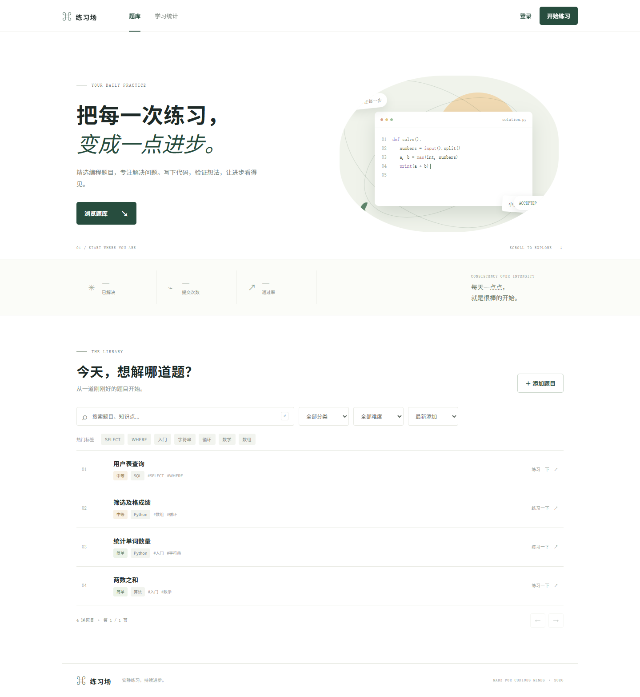
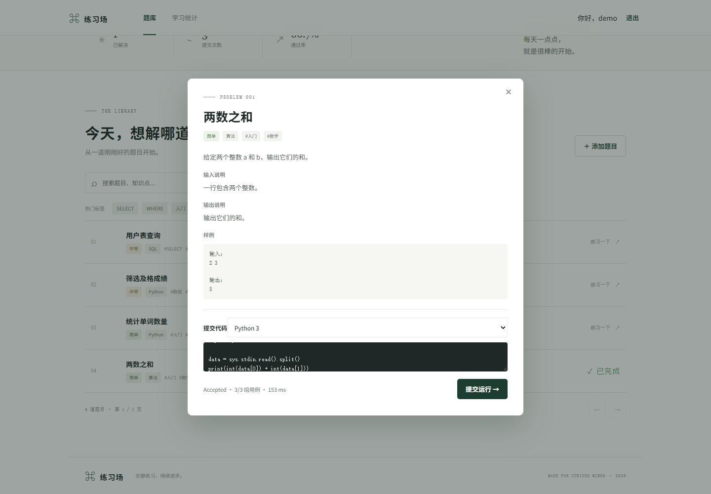
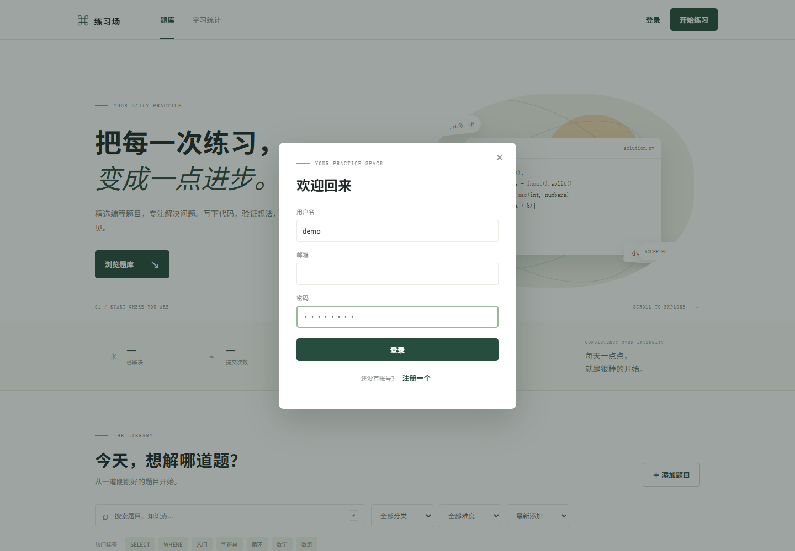
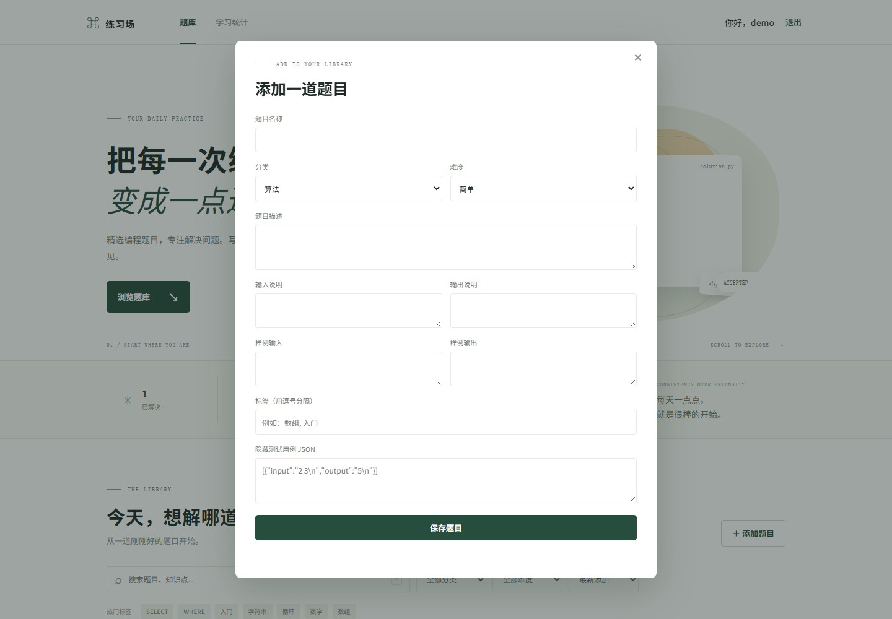
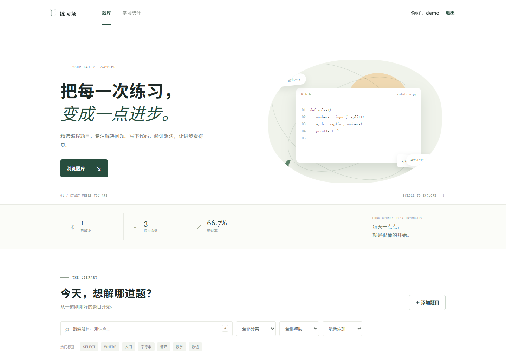

# 练习场 · 轻量级在线判题系统

面向个人学习的轻量 OJ：FastAPI + SQLAlchemy + Alembic + MySQL 8，前端使用原生 HTML、CSS、JavaScript。支持账号注册登录、题目管理、标签筛选、异步提交判题和学习统计。

## 快速启动

需要安装并启动 Docker Desktop。在项目根目录运行：

```bash
docker compose up --build
```

首次启动会自动运行 Alembic 迁移、写入种子题目并启动 Web 服务。打开 http://localhost:8000；API 文档在 http://localhost:8000/docs，健康检查在 http://localhost:8000/health。

种子账号：用户名 `demo`，密码 `demo1234`。公开部署前请修改 `docker-compose.yml` 中数据库口令和 `JWT_SECRET`，并使用 HTTPS。

## 从 GitHub 克隆

```bash
git clone https://github.com/<你的用户名>/text2.git
cd text2
```

克隆后按下面「本地运行」或「快速启动（Docker）」任选一种方式启动即可。仓库里不包含 `.venv`、`oj.db`、`.env` 等本地文件（见 `.gitignore`），首次运行会自动生成 SQLite 数据库并写入种子数据。

> 公开部署前务必修改 `JWT_SECRET` 和数据库口令，并注意本项目的判题器会直接执行提交的代码，只适合个人或小范围可信用户使用。

## 界面预览

| 首页题库 | 题目详情与判题结果 |
| --- | --- |
|  |  |

| 登录 | 添加题目 | 学习统计 |
| --- | --- | --- |
|  |  |  |

## 本地运行

需要 Python 3.10+（判题时 Python 代码直接用当前解释器运行，不依赖系统里的 `python3` 命令）。不配置 `DATABASE_URL` 时开发默认使用 SQLite；C/C++/JavaScript 判题需要系统安装 gcc、g++、Node.js。

```bash
python -m venv .venv
# Windows: .venv\Scripts\Activate.ps1
# macOS/Linux: source .venv/bin/activate
pip install -r requirements.txt
alembic upgrade head
python -m app.seed
uvicorn app.main:app --reload
```

可通过环境变量 `DATABASE_URL`、`JWT_SECRET`、`JWT_EXPIRE_MINUTES`、`RUNNER_TIMEOUT_SECONDS` 和 `RUNNER_MEMORY_MB` 配置连接与限制。

## 功能

- bcrypt 密码哈希与 HS256 JWT 鉴权。
- 公共题库及用户录题；支持简单/中等/困难、SQL/Python/算法、题目标签和隐藏测试用例。
- 关键词搜索、分类/难度筛选、多标签同时命中、分页和排序。
- 提交接口立即返回编号，后台执行 Python、JavaScript、C 或 C++；支持 Pending、Accepted、Wrong Answer、Time Limit Exceeded、Runtime Error、Compile Error。
- 比较输出时忽略每行尾部空白和末尾空行；记录代码、语言、耗时、状态和通过用例数。
- 记录用户题目进度，统计解决数、提交正确率及分类/难度分布。
- Docker Compose 启动 MySQL 8 和 Web 服务；启动时自动执行迁移与幂等种子数据。

判题器优先使用当前解释器运行 Python 代码，因此 Windows 和 Linux/macOS 都能直接工作；Node.js、gcc、g++ 需要额外安装（Windows 建议安装 Node.js 与 MinGW-w64 并加入 PATH）。POSIX 下会给子进程设置 CPU、地址空间和文件大小限制，并用进程组超时清理；Windows 下通过 `taskkill /T` 结束整棵进程树，超时与输出比较逻辑一致。判题容器仍共享 Web 容器权限；如果要面向公网运行不可信代码，应进一步使用独立低权限容器、网络隔离、只读文件系统和 seccomp 等隔离措施。

## API

- `POST /api/auth/register`、`POST /api/auth/login`、`GET /api/auth/me`
- `GET /api/problems`、`GET /api/problems/{id}`、`POST /api/problems`
- `GET /api/tags`
- `POST /api/problems/{id}/submissions`、`GET /api/submissions/{id}`
- `GET /api/problems/{id}/submissions`、`GET /api/stats/summary`

认证接口返回 `access_token`；受保护接口使用 `Authorization: Bearer <token>`。创建题目的 `test_cases` 为 `{ "input": "...", "output": "..." }` 数组。
