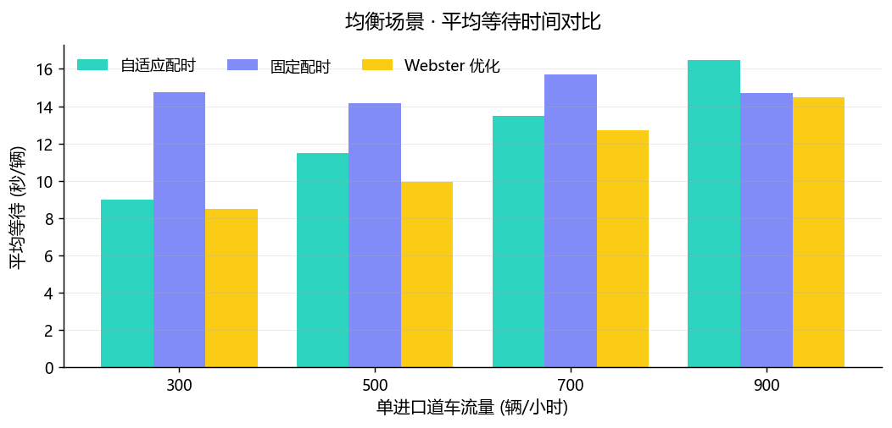
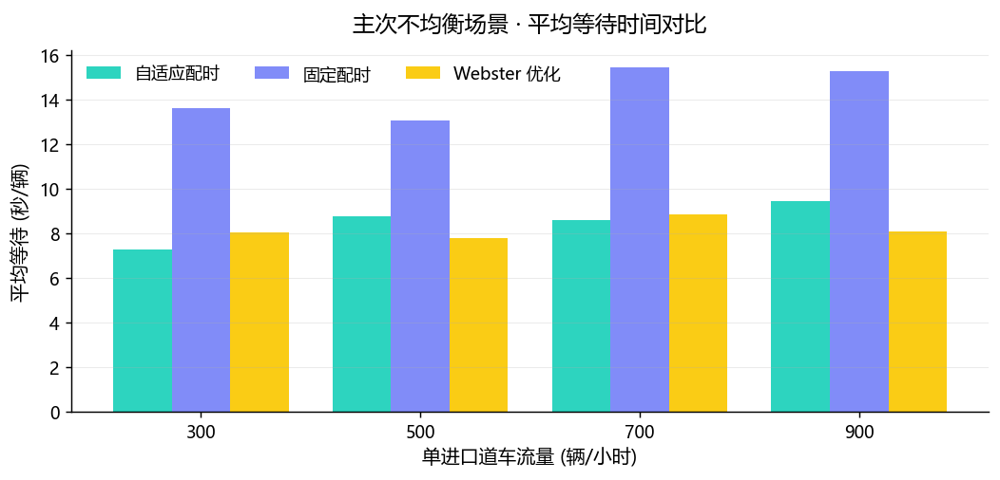
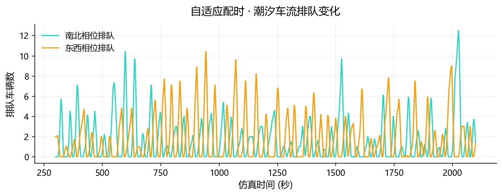

# 自适应路口交通信号配时仿真系统

基于 **Python + Pygame** 的十字路口微观交通仿真平台：模拟路口车流运行，对比
**固定配时、基于排队长度的自适应配时、Webster 离线优化配时**三种信号控制方案，
量化评估不同车流场景下的通行效率，为信号灯控制策略提供直观的仿真验证。

本项目在原「固定 vs 自适应」两方案的基础上做了系统性的**重构与优化**（见
[优化说明](#优化说明)），并补充了实测数据与完整实验结论。

---

## 一、功能特性

- **微观交通仿真**：三车道十字路口、左/直/右转向车流、泊松过程车辆到达；
- **IDM 跟驰模型**：车辆加减速平滑、有安全车距，不会穿模，比「红灯停绿灯走」更真实；
- **三种信号策略**：固定配时、排队感应自适应配时（gap-out）、Webster 最优周期优化；
- **多路口网格 + 绿波协调**：2×2、3×3 等矩形路网，相邻路口按相位差实现绿波联动；
- **多场景实验**：均衡车流、主次干道不均衡、潮汐时变车流三组场景；
- **交通评价指标**：平均等待、P95 分位等待、最大/平均排队、吞吐量、服务率（v/c）；
- **数据持久化**：SQLite（默认，零配置）与 MySQL（设环境变量即切换）双后端；
- **四套界面**：Pygame 桌面端、Flask Web 控制台、命令行批量实验、单文件 HTML 报告；
- **图表导出**：matplotlib 自动生成对比柱状图与排队时间序列；
- **单元测试**：26 个测试用例覆盖算法、指标、确定性、存储与多路口绿波协调。

---

## 二、快速开始

```bash
# 1. 安装依赖（Python 3.9+）
pip install -r requirements.txt

# 2. 启动桌面仿真（默认 3×3 网格，可切 2×2 / 1×1）
python main.py
python main.py --speed 20                    # 20 倍速启动（运行中按 + / - 调速）
python main.py --grid 2x2 --no-coordinated   # 2×2 网格，各路口独立配时

# 3. 启动 Web 控制台（浏览器打开 http://127.0.0.1:8050）
python main.py --web

# 4. 批量对比实验（生成图表 + 写入数据库）
python -m apps.batch_experiment

# 5. 多路口网格绿波协调实验（并行加速 + 进度条）
python -m apps.batch_network --grid 2x2 3x3 --lite
python -m apps.batch_network --grid 2x2 3x3 --jobs 8   # 8 进程并行

# 6. 生成单文件 HTML 报告（含实时动画 + 对比图表）
python -m apps.html_report --grid 3x2

# 7. 运行单元测试
python -m unittest discover -s tests -v
```

> 无 MySQL 也能完整运行：默认用项目内 `data/traffic_sim.db` 的 SQLite。
> 需要 MySQL 时，设置环境变量 `MYSQL_HOST` / `MYSQL_USER` / `MYSQL_PASSWORD`
> / `MYSQL_DATABASE` 即可无缝切换。

---

## 三、项目结构

```
traffic_sim/
├── config.py               # 全局配置（几何、车流、信号、配色、数据库）
├── engine.py               # 仿真引擎（车辆生成、运动、排队、指标采集）
├── engine_network.py       # 多路口网格仿真引擎（路段、跨路口、绿波协调）
├── storage.py              # 数据持久化（SQLite / MySQL 双后端）
├── charts.py               # matplotlib 图表导出
├── main.py                 # 入口（桌面 / Web / 批量）
├── models/
│   ├── track.py            # 路口拓扑与行驶轨迹（标量几何，不依赖 pygame）
│   ├── vehicle.py          # 车辆模型（IDM 跟驰 + 排队状态机）
│   └── network.py          # 网格路网（多路口、路段、绿波相位差）
├── controllers/
│   ├── base.py             # 信号相位状态机（绿→黄→全红→绿）
│   ├── strategies.py       # 固定 / 自适应 / Webster 三种策略
│   └── coordinated.py      # 绿波协调控制器（相位差 + 定周期）
├── metrics/
│   └── statistics.py       # 交通评价指标计算
├── apps/
│   ├── desktop.py          # Pygame 桌面端
│   ├── web_app.py          # Flask Web 控制台
│   ├── batch_experiment.py # 单路口批量对比实验
│   ├── batch_network.py    # 多路口网格绿波协调实验
│   └── html_report.py      # 单文件 HTML 报告生成
├── tests/                  # 单元测试
├── results/                # 实验图表与 summary.json
├── report/                 # HTML 报告
└── data/                   # SQLite 数据库
```

核心设计原则：**仿真逻辑与渲染解耦**（引擎纯标量计算、确定性可复现），
**控制策略与相位状态机解耦**（三种算法共享同一框架公平对比），
**存储后端可替换**（统一接口，SQLite/MySQL 切换）。

---

## 四、信号控制策略

| 策略 | 原理 | 适用场景 | 局限 |
|------|------|---------|------|
| **固定配时** | 各相位绿灯时长恒定 | 需求已知且稳定 | 无法应对波动/不均衡 |
| **自适应配时** | 实时车流反馈：有车续行则延长（gap-out 判定），车流断则切换 | 需求未知或时变 | 需检测设备，有微小切换开销 |
| **Webster 优化** | `C0=(1.5L+5)/(1-Y)` 离线计算最优周期与绿信比 | 需求已知且稳定 | 无法在线调整，时变时失配 |

自适应配时的核心是 **gap-out 机制**：以最短绿灯起步，绿灯期间只要仍有车辆
持续越过停车线就逐秒延长（直到最长绿灯），一旦车流出现空档（连续 3 秒无车
越过停车线）立即结束绿灯，把时间让给另一方向。同时内置「最长等待」公平性
兜底，避免某一方向被长期饿死。

---

## 五、实验结果（统计期 1800s）

三组场景下，以固定配时为基准的平均等待时间改善（负值 = 更好）：

### 1. 均衡车流（四进口道车流相等）
| 车流(辆/时) | 固定 | 自适应 | Webster |
|------------|------|--------|---------|
| 300 | 14.77s | 8.97s（**-39.3%**） | 8.48s（**-42.6%**） |
| 500 | 14.18s | 11.48s（**-19.0%**） | 9.95s（**-29.8%**） |
| 700 | 15.72s | 13.47s（**-14.3%**） | 12.69s（**-19.3%**） |
| 900 | 14.72s | 16.48s（+12.0%） | 14.49s（-1.6%） |



### 2. 主次不均衡车流（南北主干道 / 东西次干道 = 1 : 0.3）
| 车流(辆/时) | 固定 | 自适应 | Webster |
|------------|------|--------|---------|
| 300 | 13.62s | 7.26s（**-46.7%**） | 8.03s（**-41.0%**） |
| 500 | 13.06s | 8.78s（**-32.8%**） | 7.80s（**-40.3%**） |
| 700 | 15.45s | 8.60s（**-44.3%**） | 8.87s（**-42.6%**） |
| 900 | 15.28s | 9.44s（**-38.2%**） | 8.09s（**-47.1%**） |



### 3. 潮汐车流（早高峰南北多 → 晚高峰东西多 → 平峰均衡，时变需求）
| 策略 | 平均等待 | 相对固定 |
|------|---------|---------|
| 固定配时 | 14.62s | — |
| **自适应配时** | 9.82s | **-32.8%** |
| Webster 优化 | 17.52s | **+19.8%** ⚠️ |



### 结论

1. **需求已知且稳定** → **Webster 最优**（离线算好最优周期与绿信比），自适应次之；
2. **需求不均衡（主次干道）** → 自适应与 Webster 都能把绿灯让给繁忙方向，
   均比固定配时降低约 40% 的等待；
3. **需求时变（潮汐车流）** → **只有自适应配时有效**（-32.8%），Webster 因
   按平均需求离线计算而失配（反而 +19.8%），固定配时无法应对。

完整数据见 `results/summary.json`，历史记录存于 `data/traffic_sim.db`。

---

## 六、优化说明（相对原方案）

| 维度 | 原方案 | 本方案优化 |
|------|--------|-----------|
| 车辆运动 | 红灯停、绿灯走二值逻辑 | IDM 跟驰模型 + 安全车距，平滑加减速不穿模 |
| 车道结构 | 未明确 | 三车道、左/直/右转向 + 贝塞尔转弯轨迹 |
| 控制算法 | 固定 + 简单排队反馈 | 三种策略 + 标准 gap-out 感应控制 + Webster 公式 |
| 场景覆盖 | 单一车流 | 均衡 / 不均衡 / 潮汐时变三组场景 |
| 评价指标 | 平均等待、排队、吞吐 | 新增 P95 分位、服务率(v/c)、相位绿灯统计 |
| 存储 | 仅 MySQL（需装服务器） | SQLite 默认 + MySQL 可选，零配置即可运行 |
| 界面 | 仅 Pygame | Pygame + Flask Web 控制台 + 批量 CLI |
| 工程 | — | 单元测试、图表导出、确定性随机种子、模块化分层 |

---

## 七、多路口网格与绿波协调

### 路网模型

单路口可扩展为 `rows × cols` 矩形网格（如 2×2、3×3）。相邻路口由「路段」连接，
车辆驶离一个路口后沿路段行驶到下一路口的进口道再转向；网格外围边界作为车流入口。

**桌面端也支持网格渲染**：`python main.py` 默认打开 3×3 网格，`--grid 2x2` 切换尺寸，
`--no-coordinated` 关闭绿波协调，按 `C` 键在运行中切换协调开关。

**加速（倍速）**：运行中按 `+` / `-` 在 `×1 → ×2 → ×5 → ×10 → ×25 → ×50 → ×100` 之间调速，
面板显示当前倍速、实验进度百分比与进度条；也可启动时用 `--speed 20` 直接指定。
高倍速下仍按固定仿真步长推进，结果与实时运行完全一致。

**批量实验加速**：`python -m apps.batch_network --jobs N` 用多进程并行跑各组合，
并显示实时进度条与预计剩余时间（`--jobs 0` 自动取 CPU 核数）。

### 绿波协调（相位差）

| 模式 | 原理 | 适用场景 |
|------|------|---------|
| 独立配时 | 各路口独立运行自己的信号策略 | 通用基线 |
| **绿波协调** | 所有路口共享公共周期，按「路段长度 ÷ 车速」设置相位差，绿灯沿主干道依次错开 | 有主导方向的干线（如早高峰单向潮汐） |

**实验结论（方向偏置 3 倍 = 单向潮汐主干道，统计期 360s）：**

| 网格 | 独立·平均等待 | 绿波协调·平均等待 | 改善 | 独立·最大排队 | 协调·最大排队 |
|------|--------------|------------------|------|--------------|--------------|
| 2×2 | 69.79s | 52.53s | **-24.7%** | 241 | 221 |
| 3×3 | 72.36s | 56.74s | **-21.6%** | 444 | 317 |

> 绿波协调的意义在于**方向性**：单向主干道越明显，改善越大（3×3 下最大排队从
> 444 辆降到 317 辆）；双向均衡车流下，固定绿波优化一个方向会牺牲另一方向，
> 此时更适合自适应配时或 Webster 优化。

### 单文件 HTML 报告

```bash
python -m apps.html_report --grid 3x2   # 生成 report/report.html
```

生成的自包含 HTML（无需服务器，浏览器直接打开）包含：
路口车流 Canvas 实时动画、信号灯状态、指标对比表、内嵌对比图表与绿波原理说明。

---

## 八、技术栈

Python · Pygame（渲染）· NumPy（统计）· matplotlib（图表）·
SQLite / PyMySQL（存储）· Flask（Web）· IDM 跟驰模型 · Webster 信号配时公式
